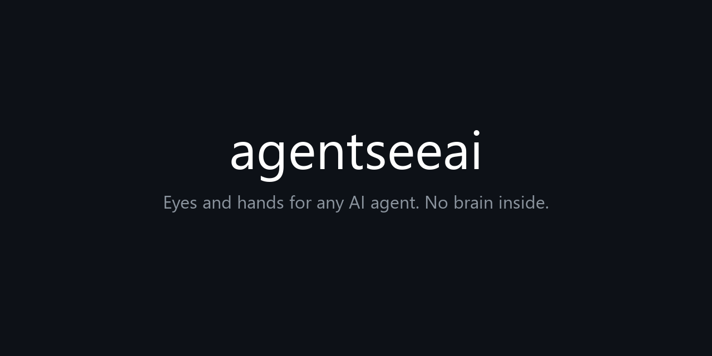

# agentseeai



<video src="demo.mp4" controls width="640"></video>

[](https://github.com/BilalAjmad/agentseeai/actions)
[](https://python.org)
[](LICENSE)
[](https://github.com/BilalAjmad/agentseeai)

**Eyes and hands for any AI agent. No brain inside.**

## Quick demo (3 lines)

```bash
pip install mss pyautogui pillow pyperclip pynput
python agentseeai.py doctor
python agentseeai.py shot
```

Agentseeai has NO brain. It does NOT think, does NOT decide, does NOT have an AI. It is only the body: it gives your AI agent full eyes (see the screen) and full hands (do anything on the computer). With Agentseeai, your AI can do ANYTHING a human can do on a computer - open apps, browse the web, fill forms, edit files, manage windows, copy/paste, click buttons, type text, read the screen, and more. The AI agent you already use (Claude, Codex, Gemini CLI, Cursor, or a local model) is the brain that decides what to do. Agentseeai is just the eyes and hands that execute it. No AI, no API key, no cloud inside Agentseeai.

## Install (copy-paste, 3 steps)

**Step 1 - Python 3.11+** (https://python.org) if not installed.

**Step 2 - Copy-paste this into your terminal:**

Windows (PowerShell):
```
pip install mss pyautogui pillow pyperclip pynput
```

Mac/Linux:
```
pip3 install mss pyautogui pillow pyperclip pynput
```

Optional (for OCR screen text):
```
pip install pytesseract
```
(Also install tesseract binary: Windows from https://github.com/UB-Mannheim/tesseract/wiki, Mac: `brew install tesseract`, Linux: `sudo apt install tesseract-ocr`)

Optional (Windows UI tree):
```
pip install uiautomation
```

Optional (macOS UI tree):
```
pip install atomacos
```

Optional (Linux UI tree):
```
sudo apt install python3-gi gir1.2-atspi-2.0
```

**Step 3 - Test it works:**
```
python agentseeai.py doctor
python agentseeai.py shot
```

Done. That is the whole install. No Docker, no sandbox, no cloud, no API key.

## Use with an AI agent

**Claude Code:**
```
claude mcp add agentseeai -- python agentseeai.py mcp
```

**Cursor / Codex / Gemini CLI:** command = `python`, args = `["agentseeai.py", "mcp"]`.

**Any agent with a terminal (no MCP needed):**
```
python agentseeai.py shot
python agentseeai.py click 640 360
python agentseeai.py type "hello"
python agentseeai.py key ctrl+s
python agentseeai.py wait 8
python agentseeai.py tree
python agentseeai.py find "Login"
python agentseeai.py click_text Login
```

## Live viewer (watch in browser)

```
python agentseeai.py view
```
Prints `http://127.0.0.1:8765/?t=TOKEN`. Open in browser. STOP blocks all actions, Resume restores, Approve/Deny answer approval requests.

## What it can do (full list)

**Eyes (seeing):**
- `screenshot` - capture screen (max 1280px wide), returns image + "% changed since last look"
- `read_screen` - OCR the screen to text (needs tesseract)
- `elements` - dump accessibility tree (buttons, inputs, windows with coordinates)
- `find_text` / `click_text` - find or click UI elements by name
- `zoom` - magnify a region 2x
- `record` - capture N seconds as a contact sheet of frames

**Hands (doing):**
- `click(x,y,button,clicks)` - left/right/middle, single/double
- `move(x,y)` - hover
- `drag(x1,y1,x2,y2)` - drag
- `scroll(amount)` / `hscroll(amount)` - vertical/horizontal scroll
- `type_text(text)` - any language (uses clipboard for non-ASCII)
- `key(combo)` - Enter, Tab, Ctrl+S, Alt+Tab, Cmd+Space, etc.
- `hold_key(key, seconds)` - hold a key
- `mouse_down` / `mouse_up` - press/release button
- `cursor_position` - where the mouse is

**Live feedback:**
- `wait_change(seconds)` - block until screen changes
- `wait_for_text(text, seconds)` - block until text appears
- `events` - JSON line per action (tail with `agentseeai events`)

**Info:**
- `windows` - list all windows
- `focus(title)` - focus a window
- `open_app(name)` - launch an app
- `clip_get` / `clip_set` - clipboard
- `screens` / `set_screen(idx)` - multi-monitor
- `status` - platform, monitors, config

**Safety / cowork (human-in-the-loop):**
- `ask_approval(question, timeout)` - blocks until human approves/denies in viewer
- Mouse to any screen corner = instant abort
- Human moves mouse = agent pauses, must re-look
- `~/.agentseeai_stop` file = hard stop (delete to resume)
- App allowlist/denylist + max actions per minute
- Every action logged to `~/.agentseeai_actions.log`
- Live viewer at localhost:8765 with STOP / Resume / Approve / Deny buttons

## How it works

1. You give a task to your AI agent (Claude, Codex, etc.).
2. The agent calls Agentseeai tools: "screenshot" to see, "click 640 360" to act.
3. Agentseeai runs the action on your real desktop and returns a new screenshot + "screen changed X%".
4. The agent sees the result and decides the next step. Repeat.

Agentseeai never thinks. It only sees and acts. Your AI agent is the brain. Agentseeai is the eyes and hands.

## Config

`~/.agentseeai.json`:
```json
{
  "max_width": 1280,
  "port": 8765,
  "monitor": 1,
  "allowlist": [],
  "denylist": ["Taskmgr.exe", "SystemSettings.exe"],
  "max_actions_per_minute": 60,
  "settle_ms": 400,
  "ocr_lang": "eng"
}
```

## Coordinates

The agent always uses pixels of the LAST screenshot (max width 1280). Agentseeai maps them to the real screen (retina, DPI, multi-monitor safe). Every action returns (new screenshot, "changed X%").

## Safety

- Mouse to any corner = abort.
- Human moves mouse = pause + re-plan.
- `touch ~/.agentseeai_stop` = hard stop.
- Viewer: localhost only, random token, hmac.compare_digest, Origin check, POST for stop/resume/answer.
- App allowlist/denylist, rate limit, action log file.

## Scope (real desktop, no sandbox)

Controls your real desktop fully. Run elevated (Administrator) to also act on elevated windows. Only OS-protected things are off-limits: secure desktop (UAC/lock screen), DRM frames, anti-cheat input, macOS permission prompts (grant once), Wayland (needs ydotool/portal). Everything else is controllable. No Docker, no sandbox, no cloud, no API key.

## Files

- `agentseeai.py` - core (single file)
- `agentseeai_agent.py` - optional agent for people without an AI (uses local Ollama/OpenAI-compatible server)
- `tests/test_agentseeai.py` - 20 tests (run on Xvfb or real display)
- `Dockerfile` + `docker-entrypoint.sh` - optional sandbox desktop
- `setup.bat` / `setup.sh` - one-click dependency install

## License

MIT