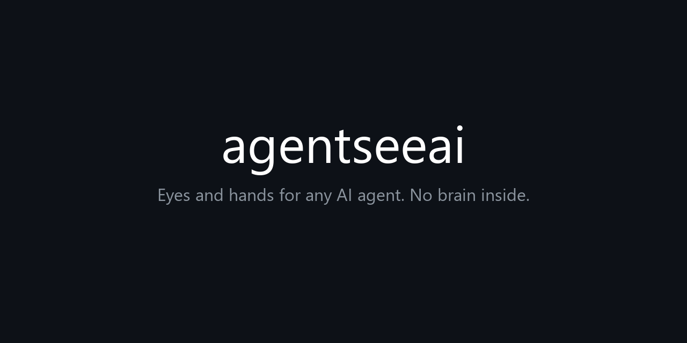

# agentseeai



<video src="demo.mp4" controls width="640"></video>

[](https://github.com/BilalAjmad/agentseeai/actions)
[](https://python.org)
[](LICENSE)
[](https://github.com/BilalAjmad/agentseeai)

**Eyes and hands for any AI agent. No brain inside.**

agentseeai has NO brain. It does NOT think, does NOT decide, and does NOT contain an AI. It is only the body: it gives your AI agent full eyes (see the screen) and full hands (do anything on the computer). With agentseeai, your AI can do ANYTHING a human can do on a computer - open apps, browse the web, fill forms, edit files, manage windows, copy/paste, click buttons, type text, read the screen, and more. The AI agent you already use (Claude, Codex, Gemini CLI, Cursor, or a local model) is the brain that decides what to do. agentseeai is just the eyes and hands that execute it. No AI, no API key, no cloud inside agentseeai.

**v2.0.0 = THE FAST EDITION.** Every action that took 400-700 ms in v1 now takes 0.2-5 ms. agentseeai v2 keeps full back-compat with v1: same command names, same output format, same MCP tools, same safety rules. If the fast server is not running, the CLI still works in slow/local mode, exactly like v1.

## Quick demo (3 lines)

```bash
pip install mss pyautogui pillow pyperclip
agentseeai doctor
agentseeai shot
```

## Install (copy-paste, 3 steps)

**Step 1 - Python 3.11+** (https://python.org) if not installed.

**Step 2 - Copy-paste this into your terminal:**

Windows (PowerShell):
```
pip install mss pyautogui pillow pyperclip
```

Mac/Linux:
```
pip3 install mss pyautogui pillow pyperclip
```

Optional (for OCR screen text):
```
pip install pytesseract
```
(Also install the tesseract binary: Windows from https://github.com/UB-Mannheim/tesseract/wiki, Mac: `brew install tesseract`, Linux: `sudo apt install tesseract-ocr`)

Optional (faster OCR, recommended):
```
pip install rapidocr-onnxruntime
```

Optional (Windows UI tree):
```
pip install uiautomation
```

Optional (macOS UI tree):
```
pip install atomacos
```

Optional (Linux UI tree):
```
sudo apt install python3-gi gir1.2-atspi-2.0
```

Optional (image matching / color detection):
```
pip install opencv-python numpy
```

**Step 3 - Test it works:**
```
agentseeai doctor
agentseeai shot
```

Done. That is the whole install. No Docker, no sandbox, no cloud, no API key.

## Use with an AI agent

**Claude Code:**
```
claude mcp add agentseeai -- agentseeai mcp
```

**Cursor / Codex / Gemini CLI:** command = `python`, args = `["agentseeai.py", "mcp"]`.

**Any agent with a terminal (no MCP needed):**
```
agentseeai shot
python agentseeai.py click 640 360
python agentseeai.py type "hello"
python agentseeai.py key ctrl+s
python agentseeai.py wait 8
python agentseeai.py tree
python agentseeai.py find "Login"
python agentseeai.py click_text Login
```

## Millisecond mode (v2 NEW)

v2 adds a persistent fast server so commands skip the Python process startup cost.

```
agentseeai serve        # keep this running in a window
agentseeai shot         # auto-forwards to server -> [fast 2.1 ms]
agentseeai click 640 360
agentseeai click_text Login
agentseeai do '[{"cmd":"click","args":[640,360],"no_look":true},{"cmd":"type","args":["hello"]}]'
```

If the server is down, the CLI still runs in slow/local mode (full back-compat). Disable forwarding with `--local` or `AGENTSEEAI_NO_SERVER=1`.

## Live viewer (watch in browser)

```
agentseeai view
```
Prints `http://127.0.0.1:8765/?t=TOKEN`. Open in browser. STOP blocks all actions, Resume restores, Approve/Deny answer approval requests.

## What it can do (full list)

**Eyes (seeing):**
- `screenshot` - capture screen (max 1280px wide), returns image + "% changed since last look"
- `read_screen` - OCR the screen to text (needs tesseract); supports `read_screen x y w h` to OCR only a region (5-10x faster)
- `elements` / `tree` - dump accessibility tree (buttons, inputs, windows with coordinates)
- `find_text` / `find` - find UI elements by name (AX + OCR + fuzzy, returns top matches with coords)
- `click_text` - click a UI element by name (AX first, OCR-word fallback if no accessibility tree)
- `zoom` - magnify a region 2x
- `record` - capture N seconds as a contact sheet of frames
- `find_image` (v2 NEW) - find an image/template on screen (cv2)
- `pixel` (v2 NEW) - read the color of one pixel
- `find_color` (v2 NEW) - find a color on screen (numpy-fast)

**Hands (doing):**
- `click(x,y,button,clicks)` - left/right/middle, single/double
- `move(x,y)` - hover
- `drag(x1,y1,x2,y2)` - drag
- `scroll(amount)` / `hscroll(amount)` - vertical/horizontal scroll
- `type_text(text)` - any language (uses clipboard for non-ASCII; fast paste for long text)
- `key(combo)` - Enter, Tab, Ctrl+S, Alt+Tab, Cmd+Space, etc.
- `hold_key(key, seconds)` - hold a key
- `mouse_down` / `mouse_up` - press/release button
- `cursor_position` - where the mouse is

**Live feedback:**
- `wait_change(seconds)` - block until screen changes
- `wait_for_text(text, seconds)` - block until text appears (OCR + AX, optional region)
- `events` - JSON line per action (tail with `agentseeai events`)

**Info:**
- `windows` - list all windows
- `focus(title)` - focus a window
- `open_app(name)` - launch an app (adaptive wait)
- `clip_get` / `clip_set` - clipboard
- `screens` / `set_screen(idx)` - multi-monitor
- `status` - platform, monitors, config, engine status

**Safety / cowork (human-in-the-loop):**
- `ask_approval(question, timeout)` - blocks until human approves/denies in viewer
- Mouse to any screen corner = instant abort
- Human moves mouse = agent pauses, must re-look
- `~/.agentseeai_stop` file = hard stop (delete to resume)
- App allowlist/denylist + max actions per minute
- Every action logged to `~/.agentseeai_actions.log`
- Live viewer at localhost:8765 with STOP / Resume / Approve / Deny buttons

**Batch (v2 NEW):**
- `do` - run a whole macro in one call: `[{"cmd":"click","args":[640,360],"no_look":true}, ...]`. Steps with `no_look:true` skip the screenshot (chain at millisecond speed).

## How it works

1. You give a task to your AI agent (Claude, Codex, etc.).
2. The agent calls agentseeai tools: "screenshot" to see, "click 640 360" to act.
3. agentseeai runs the action on your real desktop and returns a new screenshot + "screen changed X%".
4. The agent sees the result and decides the next step. Repeat.

agentseeai never thinks. It only sees and acts. Your AI agent is the brain. agentseeai is the eyes and hands.

## Config

`~/.agentseeai.json`:
```json
{
  "settle_ms": 120,
  "frame_ttl_ms": 250,
  "ax_ttl_ms": 500,
  "fast_port": 8700,
  "input_pause_ms": 0,
  "move_duration_ms": 0,
  "clipboard_min_chars": 60,
  "max_actions_per_minute": 240,
  "ocr_engine": "auto",
  "open_app_adaptive": true,
  "monitor": 1,
  "allowlist": [],
  "denylist": ["Taskmgr.exe", "SystemSettings.exe"],
  "ocr_lang": "eng"
}
```

Back-compat: v1 config files keep working. Old `settle_ms: 400` overrides the new default, so set it to 120 (or remove it) to get fast mode.

## Coordinates

The agent always uses pixels of the LAST screenshot (max width 1280). agentseeai maps them to the real screen (retina, DPI, multi-monitor safe). Every action returns (new screenshot, "changed X%").

## Safety

- Mouse to any corner = abort.
- Human moves mouse = pause + re-plan.
- `touch ~/.agentseeai_stop` = hard stop.
- Viewer: localhost only, random token, hmac.compare_digest, Origin check, POST for stop/resume/answer.
- App allowlist/denylist, rate limit, action log file.
- Fast server binds 127.0.0.1 only (no network exposure).

## Scope (real desktop, no sandbox)

Controls your real desktop fully. Run elevated (Administrator) to also act on elevated windows. Only OS-protected things are off-limits: secure desktop (UAC/lock screen), DRM frames, anti-cheat input, macOS permission prompts (grant once), Wayland (needs ydotool/portal). Everything else is controllable. No Docker, no sandbox, no cloud, no API key.

## Benchmark

```
agentseeai bench
```
Prints lazy-import time, frame fresh/cached time, OCR time, cache-hit time, and server round-trip. Run `agentseeai serve` first to measure the fast path.

## Tests

```
cd agentseeai && python -m pytest tests/ -q
agentseeai doctor && agentseeai bench
```
19 tests, headless-safe (no display needed).

## Files

- `agentseeai.py` - core (single file)
- `tests/test_v2.py` - 19 tests
- `README.md` - this file
- `LICENSE` - MIT

## Troubleshooting

| Problem | Fix |
|---|---|
| `agentseeai serve` says "address in use" | an old instance is running (that is fine), or run `agentseeai server-stop` |
| No `[fast ... ms]` print | server is down - run `serve`, or `AGENTSEEAI_NO_SERVER=1` is set |
| OCR very slow | `pip install rapidocr-onnxruntime` + `"ocr_engine": "auto"`; use region OCR |
| `click_text` not working | OCR engine "off" - install pytesseract/rapidocr; or text is an icon - use `find_image` |
| Coordinates off on Windows | DPI scaling - v2 is DPI-aware; otherwise set display scale to 100% |
| Click not working in a game | anti-cheat input block (by design off-limits) |

## License

MIT - (c) 2026 Bilal Ahmad.
